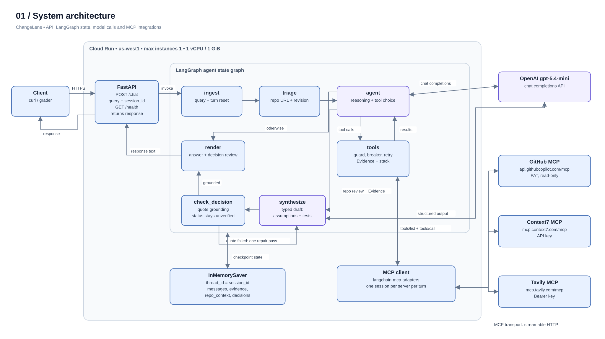
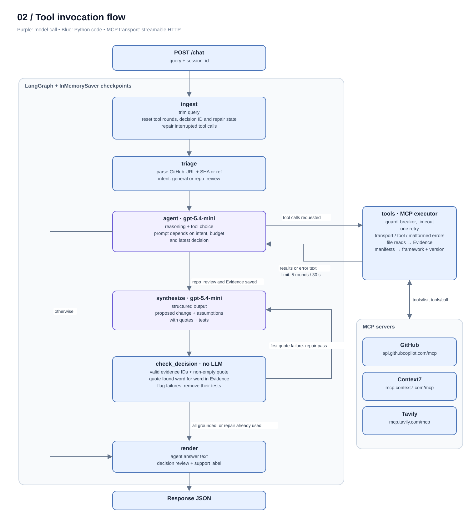
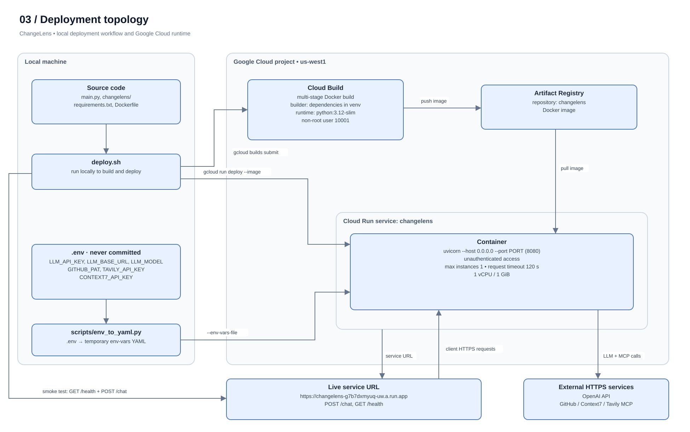

# ChangeLens

A tool-using agent for code-review questions, built for CSCI 599 Assignment 1. It answers from the model's own knowledge when no lookup is needed, and otherwise chooses among tools exposed by three real MCP servers (GitHub, Context7, Tavily). It keeps per-session conversational memory and runs on Google Cloud Run.

- **Live URL:** https://changelens-g7b7dxmyuq-uw.a.run.app
- **Framework:** LangGraph (with FastAPI and `langchain-mcp-adapters`)
- **LLM:** OpenAI `gpt-5.4-mini` through the OpenAI-compatible chat API. Set by `LLM_MODEL`, `LLM_BASE_URL` and `LLM_API_KEY`; the same code also ran on NVIDIA NIM `nemotron-3-super-120b-a12b` during development (see Evaluation).

## API

```
POST /chat
Content-Type: application/json

{"query": "string", "session_id": "string"}
```

Response: `{"response": "string"}`. Any other body gets a 422 whose body is still `{"response": "..."}`. `GET /health` returns `{"status": "ok"}`.

```bash
curl -s "$URL/chat" -H 'content-type: application/json' \
  -d '{"query":"What does the fastapi Depends function do?","session_id":"demo-1"}'
```

## Diagrams

### 1. System architecture



### 2. Tool invocation flow



### 3. Deployment topology



## How it works

For every `/chat` request the service:

1. Connects to each MCP server and runs `tools/list`. Only an allowlist of 9 read-only tools is kept.
2. Runs a LangGraph state graph: `ingest → triage → agent ⇄ tools → render`. For a repository review it continues `agent → synthesize → check_decision → render`, with one repair pass back to `synthesize` if a quote fails the check (see Workflow A below).
3. Lets the LLM decide, by the meaning of the query, whether to answer directly or call tools. There is no keyword routing. `triage` only parses input: it looks for a `github.com/<owner>/<repo>` URL (and an optional commit SHA or ref) and sets `intent` to `repo_review` or `general`. It never chooses tools.
4. Saves the conversation and the review state in the framework checkpointer, keyed by `session_id`.

### Workflow A: grounded repository review

When a query contains a GitHub repository URL, the agent reads files from the repository (pinned to the given commit) and the service produces a **decision review**: the assumptions the code makes, each with an exact quote, plus suggested tests.

| Step | Code | What it does |
|---|---|---|
| Evidence capture | `changelens/evidence.py` | Each successful GitHub file read is saved as an `Evidence` record (path, revision, exact excerpt up to 4,000 characters, or 6,000 for `requirements.txt`, `pyproject.toml` and `package.json`; plus a hash). The tool returns at most 8,000 characters per call. It is kept apart from the chat messages. |
| Stack detection | `changelens/stack.py` | Plain code reads `requirements.txt`, `pyproject.toml` or `package.json` and reports the framework and version spec, plus a label: "evaluated batch" (FastAPI, Express, NestJS) or "unevaluated stack, best-effort". |
| Synthesis | `synthesize` in `changelens/graph.py` | A second LLM call, with structured output, drafts up to 4 assumptions (each with an evidence ID and a quote) and up to 4 tests. Code assigns IDs and the status `unverified`. |
| Check | `check_decision` in `changelens/graph.py` | No LLM. An assumption is marked grounded only if its evidence ID exists and its quote appears word for word in that excerpt (whitespace collapsed, case-sensitive). Failed assumptions are shown as NOT VERIFIED and their tests are dropped. If any quote fails, `synthesize` is run once more with the failed quotes listed, and the check runs again. Never more than one repair per turn. |
| Report | `changelens/report.py` | Appended to the answer. A matching quote shows the citation is real. It does not show that the assumption is true. |

If synthesis fails or no files were read, the agent's own text is returned unchanged. Only the structured block is machine-checked. The free text above it is not.

### MCP servers

| Server | Endpoint | Tools kept | Why it is needed |
|---|---|---|---|
| GitHub | `https://api.githubcopilot.com/mcp/` | 6 | Reads code and files from public repositories |
| Context7 | `https://mcp.context7.com/mcp` | 2 | Library documentation for a specific version |
| Tavily | `https://mcp.tavily.com/mcp/` | 1 | Web search for news and release notes |

All three wrap real external systems. Nothing is simulated in production. These are hosted third-party servers used as clients, so there is nothing to install. Attribution: the GitHub server is GitHub's hosted MCP server (the open-source `github/github-mcp-server`), Context7 is provided by Upstash, and Tavily MCP is provided by Tavily. None of their code is copied into this repository. Credentials are read from environment variables.

### Memory

LangGraph's built-in `InMemorySaver` checkpointer, with `thread_id = session_id`. Different `session_id` values never see each other's messages. Memory lives in the running instance, so it is lost when the instance restarts. Cloud Run is deployed with `--max-instances 1` so one instance holds all sessions.

### Failure handling

All three required categories return a useful HTTP 200 answer and never crash the request:

| Category | Handling |
|---|---|
| Connection or transport failure | One jittered retry within the time budget. A per-server circuit breaker then skips the server for a cooldown period. The answer states which source was unavailable. |
| Tool execution error | The error kind is classified (for example not found, auth, rate limited). Only transient kinds are retried. The model receives plain failure text and cannot cite a result that was not obtained. |
| Malformed or unreadable response | A guard wraps every `tools/call` (`changelens/mcp_tools/guard.py`). It rejects a successful response that has only non-text content, a response that fails MCP validation, and invalid structured content or output schema. Each becomes a fixed "Tool error (malformed)" result, so the model cannot use the unusable content. This is treated as non-transient: no retry, and the circuit breaker is not tripped, because the server did answer. Oversized results are cut at 8,000 characters with a visible truncation note. |

Limits: at most 5 tool rounds and 30 s of tool time per request. When either is spent the model is given no tools and must answer from what it has.

## Setup and run locally

Requires Python 3.12.

```bash
cp .env.example .env            # then fill in your own keys
python -m venv .venv && source .venv/bin/activate
pip install -r requirements.txt
uvicorn changelens.api:app --port 8080
```

Keys needed: `LLM_API_KEY` (OpenAI, or any OpenAI-compatible endpoint such as NVIDIA NIM, with `LLM_BASE_URL` and `LLM_MODEL`), `GITHUB_PAT` (fine-grained, public repositories, read-only), `TAVILY_API_KEY`, `CONTEXT7_API_KEY`. `TYPESAFE_API_KEY` and `TRIAGE_BACKEND` are for a planned classifier (Jev) and are not used yet; the running service does not call it.

## Deploy to Cloud Run

Prerequisites: a Google Cloud project with the Cloud Run, Cloud Build and Artifact Registry APIs enabled, and `gcloud auth login` done.

```bash
GCP_PROJECT_ID=your-project ./deploy.sh
```

The script validates the environment file, builds the multi-stage image with Cloud Build, pushes it to Artifact Registry, deploys with `--allow-unauthenticated --max-instances 1 --timeout 120` in `us-west1`, passes the keys with `--env-vars-file`, and runs smoke tests: health, two-turn recall, session isolation and a 422 check. Use `--dry-run` to preview without creating anything. The container runs as a non-root user and binds `0.0.0.0:$PORT`.

## Tests and evidence

- Resilience tests (stub MCP server, test-only, never deployed): `pytest tests/resilience`
- Real-server failure runs: `docs/evidence/m2/` (for example Tavily pointed at an unreachable address, a missing GitHub file, a nonsense Context7 library name)
- Unit and resilience tests: `pytest` (104 tests pass, no network needed for the unit tests)
- Workflow A live runs against `fastapi/full-stack-fastapi-template` at a pinned commit, three runs including two failures and their fixes, and follow-up scenarios: `docs/evidence/m4/README.md`
- Evaluation (tool selection, chaining, memory, groundedness, latency): `docs/evidence/eval/summary.md`
- Checks against the deployed service, including cold starts: `docs/evidence/live/README.md`
- Tool selection and chaining traces, with live MCP servers: `docs/evidence/m3/`
  - no tool needed: `docs/evidence/m3/01_no_tool.txt` (0 tool calls)
  - GitHub manifest, then Context7 `resolve-library-id`, then `query-docs`: `docs/evidence/m3/02_manifest_context7_chain.txt` (5 rounds)
  - web search: `docs/evidence/m3/03_tavily.txt` (1 round)

### Agent reasoning and tool selection (requirements §3.2)

| Requirement | How it is met | Evidence |
|---|---|---|
| Select the right tool, or no tool, by meaning | The LLM sees the schemas of the 9 discovered tools and chooses. Three queries led to three different choices: none, GitHub then Context7, and Tavily. | the three `docs/evidence/m3/` traces |
| Answer from LLM knowledge when no tool is needed | `What is 2+2?` made no tool call and the answer came from the model | `01_no_tool.txt` |
| Chain at least 2 tool calls for multi-step tasks | 5 dependent rounds: GitHub file reads find the pinned FastAPI version, then Context7 `resolve-library-id` and `query-docs` fetch the documentation for it | `02_manifest_context7_chain.txt` |
| No hard-coded keyword routing | Tool choice is made only by the LLM. `route_after_agent` in `changelens/graph.py` checks whether the model's reply contains tool calls. `triage` does not pick tools or topics. It only extracts a repository URL and revision from the text and sets the review mode. | `changelens/graph.py`, `changelens/triage.py` |

## Evaluation

Run with `PYTHONPATH=. python scripts/run_eval.py` (real MCP servers and the real LLM, in-process). Results and raw rows are in `docs/evidence/eval/`. Model: `gpt-5.4-mini`. Each number has its denominator, and each query ran once.

| Metric | Result |
|---|---|
| No-tool queries made 0 tool calls | 9 / 9 |
| Tool-needed queries called an accepted server (GitHub, Context7, Tavily) | 12 / 12 |
| Chained queries made 2+ calls across the required servers | 5 / 5 |
| Memory: recall sessions and one isolation check (no leak between sessions) | 5 / 5 |
| Assumptions in 4 repository reviews whose quote matched the saved text | 7 / 8 (the other was shown as NOT VERIFIED) |
| Reviews with a decision record | 4 / 4, but 2 had 0 assumptions in that run |
| Turns over 60 s | 0 / 50 |
| Resilience tests (`pytest tests/resilience`, stub server) | 26 passed |
| Unit and resilience tests (`pytest`) | 104 passed |

Latency (seconds, laptop to real services, one run per query): no-tool p50 4.9, tool p50 7.7, chain p50 10.7, repository review p50 15.1, slowest review 19.4. With few runs per group, p95 is close to the maximum. These times do not include the HTTP layer or a Cloud Run cold start.

Baseline: the same repository review with tools switched off produced no evidence and no decision record.

Repeated runs (3 per repository, `docs/evidence/eval/review_repeat3_*.jsonl`): usefulness varies from run to run. In the latest batch 5 of 6 reviews on an Express and a NestJS repository had at least one grounded assumption. The failure was the agent not opening the right source file. No quote that failed the check was ever shown as verified. The repair step did not trigger in that batch.

An earlier model (NVIDIA NIM `nemotron-3-super-120b-a12b`) was slower and less stable on the same reviews (38 to 66 s, one 62 s review and one empty reply; see `docs/evidence/m4/README.md`). This is why the model was changed.

## Live deployment checks

Run against https://changelens-g7b7dxmyuq-uw.a.run.app on 2026-10-13 from a laptop, one run each (`docs/evidence/live/`).

| Check | Result |
|---|---|
| `GET /health` | 200, 0.1 s warm |
| Non-code question | Answered without tools, 3.4 s |
| Library question | Answered from Context7, 9.0 s |
| Recall in one session | Returned the code word given in turn 1 |
| Isolation, other session asks | No code word leaked |
| Body missing `session_id` | 422 with an explanatory message |
| Repository review (FastAPI template, pinned commit) | 4 of 4 assumptions grounded, 10.8 s |
| Follow-up in the same session | Answered from the saved review, 3.9 s |
| Cold start: a review as the first request after more than 2 hours idle | 30.8 s |
| Cold start: `/health` as the first request after 20 minutes idle | 12.7 s |

Cold start adds roughly 13 to 20 s, so a review stayed under the 60 s limit in both samples. These are two samples, not a distribution.

## Repository map

- `main.py`, `changelens/`: the service. `api.py` (FastAPI), `graph.py` (LangGraph nodes), `triage.py`, `evidence.py`, `stack.py`, `schemas.py`, `report.py`, and `mcp_tools/` (MCP connections, guard, circuit breaker).
- `tests/`: unit tests and `tests/resilience/` (stub MCP server with injected faults).
- `scripts/run_eval.py`: the evaluation runner. The other scripts in `scripts/` are the early probes (M0) and doc tools.
- `docs/evidence/`: saved runs and logs. `docs/requirements.md` is the assignment summary and `docs/architecture-plan-v3.md` the original plan.
- `deploy.sh`, `Dockerfile`, `.env.example`: build and deploy. `PROCESS_LOG.md`: development narrative.

## Cost disclosure

Prices were checked on 2026-10-13 and can change. Amounts for my own usage are estimates unless stated.

| Item | Price basis | My usage and cost |
|---|---|---|
| LLM: OpenAI `gpt-5.4-mini` | $0.75 per 1M input tokens, $4.50 per 1M output tokens, cached input $0.075 per 1M ([OpenAI pricing summary](https://openrouter.ai/openai/gpt-5.4-mini)) | The logged evaluation turns used about 1.34M input and 25k output tokens in agent calls, about **$1.1**. Synthesis calls, earlier tests and live checks add more. Estimated total under **$3**. Check the OpenAI usage page for the exact figure. A repository review costs roughly a cent or two. |
| LLM during early development: NVIDIA NIM `nemotron-3-super-120b-a12b` | Developer key | Free for development use |
| Cloud Run (`--max-instances 1`, `--min-instances 0`, 1 vCPU, 1 GiB, request-based billing) | Free tier of 180,000 vCPU-seconds, 360,000 GiB-seconds and 2M requests per month; then about $0.000024 per vCPU-second, $0.0000025 per GiB-second and $0.40 per million requests ([Cloud Run pricing](https://cloud.google.com/run/pricing)) | Test traffic is far inside the free tier: **$0** expected. Scaled to zero, nothing is billed while idle. |
| Cloud Build | 2,500 free build-minutes per month on the default machine, then $0.006 per minute ([Cloud Build pricing](https://cloud.google.com/build/pricing)) | A few builds of a few minutes each: **$0** expected |
| Artifact Registry | 0.5 GB free per month, then $0.10 per GB-month ([pricing](https://cloud.google.com/artifact-registry/pricing)) | One small image: **$0** to about **$0.10** per month |
| GitHub MCP | Free with a read-only personal access token for public repositories | **$0** |
| Context7 | Free plan of 1,000 calls per month, paid Pro plan from $20 per month ([Context7 plans](https://context7.com/docs)) | A few dozen calls: **$0** |
| Tavily | Free plan of 1,000 credits per month, then $0.008 per credit ([Tavily credits](https://docs.tavily.com/guides/api-credits)) | A handful of searches: **$0** |

The service stays up until grades are posted. With scale to zero and a few grader requests, the main running cost is the OpenAI usage per request. Setting a spending limit on the OpenAI key caps it.

## Known limitations

- Memory is in-process: it is lost when the instance restarts, and sessions do not survive scale-to-zero.
- With web search unavailable, an answer can still state a version number from library documentation in its first sentence. A fixed note at the end says the newest releases were not checked.
- The tool-round limit (5) can run out before a long multi-file investigation finishes. The answer then says what it could not check. In one live run the agent spent all its rounds on directory listings and produced no assumptions; the prompt now tells it to ration rounds.
- Workflow A is evaluated on a handful of repositories with one to three runs each. It is a smoke test, not a benchmark. With `gpt-5.4-mini` a review took 10 to 21 s locally and 10.8 s on the warm Cloud Run service. Two cold-start samples were measured (see Live deployment checks); a longer sample was not taken.
- Review quality varies between runs of the same query. Naming the files to read in the request (as in the FastAPI example above) makes reviews more reliable.
- Only the first 4,000 characters of a source file (6,000 for a manifest) are citable. A quote from later in a long file is marked NOT VERIFIED.
- `check_decision` checks citations, not truth. Assumption status stays `unverified`. A failed quote gets one repair pass, which did not trigger in the live runs I made, so it has only been checked on constructed data. There is no separate commit step: the decision lives in the checkpointer state.
- Intent is not classified by a model yet. A message without a GitHub URL always takes the general path.
- Opening the MCP connections in `changelens/api.py` has no overall timeout. One evaluation run stalled for 28 minutes in a connection step and could not be reproduced. The evaluation script guards its own turns, but the API does not.
- When asked a follow-up such as which assumptions are not verified, the model can mix the quote check with doubts of its own from the review text.
- The work stops at milestone M4 of a larger plan (`docs/architecture-plan-v3.md`). Revising stored decisions, rechecking them against a pull request, the HTML report store and cost controls were designed but not built.
