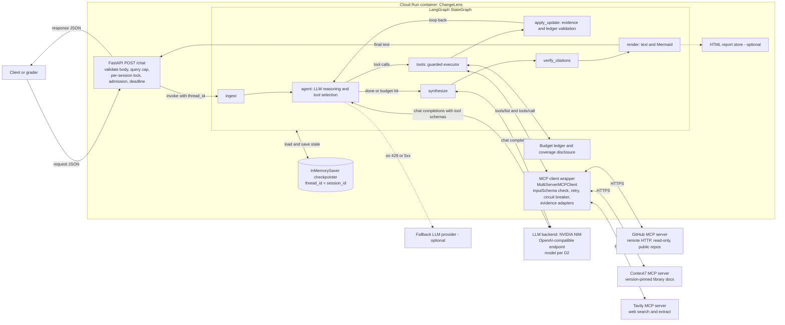
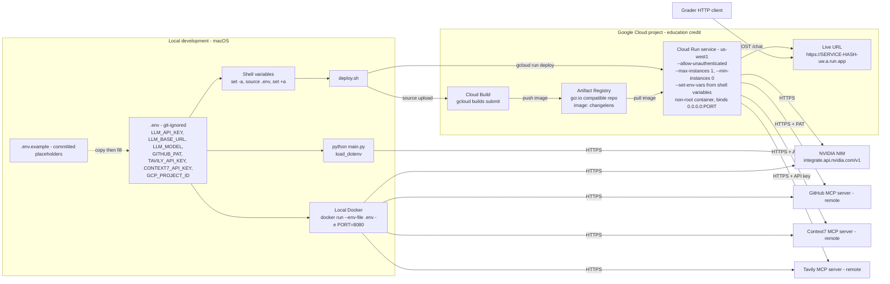
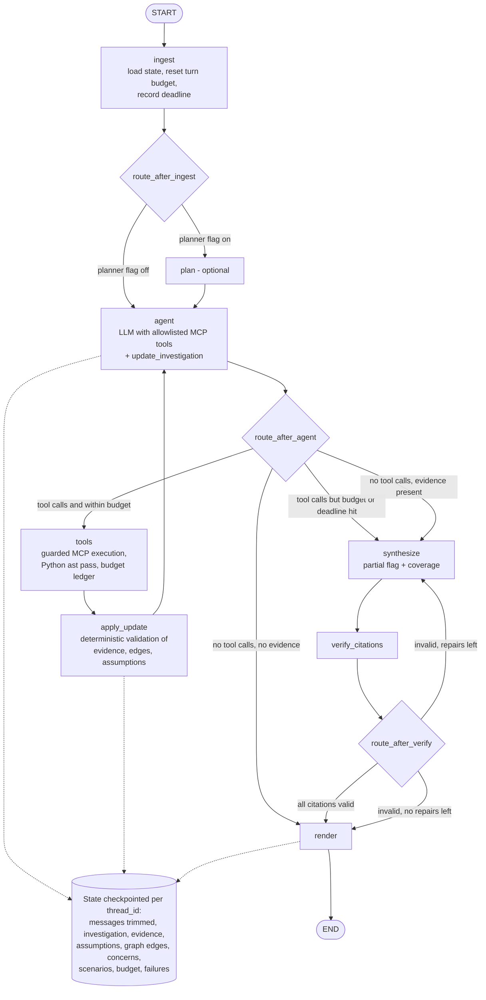
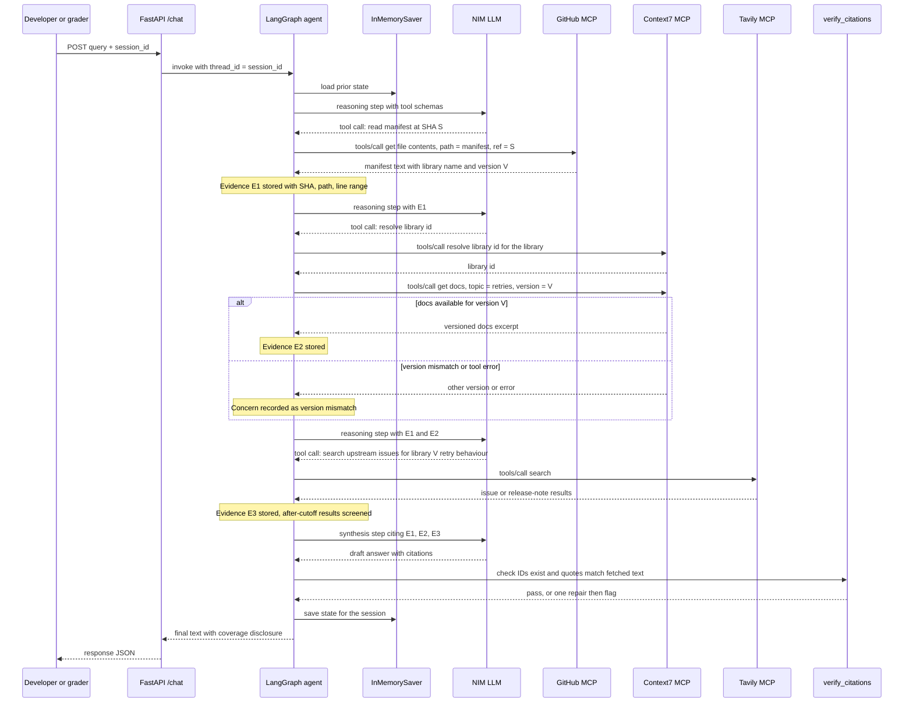

# ChangeLens v2: Provisional Design Diagrams and Staged Development Plan

> **Superseded (2026-10-06):** the current design is [architecture-plan-v3.md](architecture-plan-v3.md), the decision-memory redesign.
>
> **Carried into v3:** D1, D2 (still to be re-checked in S0d), D3–D5, D6, D8, D15 and D17, plus the raw `ClientSession` executor.
>
> **New in v3:** decision records, Workflows A/B/C, the triage-plus-modes graph and D18 (Jev triage).
>
> This file is kept for history. Its diagrams do not describe v3.

> Produced by the `research-architect` subagent on 2026-10-05 from [architecture-plan.md](architecture-plan.md) (v2).
> **Status:** design only. Every diagram below is **PROVISIONAL** and must be redrawn from the final code before submission [V: P §4.6, §7.4]. Nothing here has been implemented, run or measured.

**Claim tags**
- **[V: src §]** means the source says it.
- **[A]** is an assumption.
- **[O]** is an optional enhancement.
- **[T]** is a target hypothesis.
- **Missing** marks evidence not yet available.

---

## Part A: Diagrams (PROVISIONAL)

### Diagram 1: System architecture
- A request enters FastAPI and runs through the LangGraph state graph. Conversation state lives in `InMemorySaver`, keyed by `thread_id = session_id`.
- The `agent` node calls the NIM LLM, whose model is set by D2 after the G0 bake-off.
- The `tools` node reaches three named remote MCP servers through the guarded MCP client wrapper.
- Dashed parts are optional or not decided yet.



### Diagram 2: Tool invocation loop
- This is the loop P §4.6 requires: query → entry → LLM reasoning → tool selection → MCP `tools/call` → server response → loop back → synthesis → final response.
- It adds the no-tool exit, the budget and deadline partial exits, the three required failure branches, and citation verification.
- Every path ends with a `{"response": string}` body.

```mermaid
flowchart TD
  q["User query + session_id"] --> entry["Agent entry: ingest<br/>load checkpoint, init budget"]
  entry --> reason["LLM reasoning step"]
  reason --> need{"Tool call needed?"}
  need -->|no, no evidence gathered| notool["No-tool exit: answer from LLM knowledge"]
  need -->|no, evidence gathered| synth["LLM synthesis step<br/>cite evidence IDs"]
  need -->|yes| bud{"Budget and deadline OK?"}
  bud -->|exhausted| partial["Mark partial<br/>attach coverage disclosure"]
  partial --> synth
  bud -->|ok| select["Tool selection<br/>validate args against inputSchema"]
  select -->|args invalid, one repair| reason
  select -->|args valid| call["MCP tools/call request"]
  call --> outcome{"Outcome"}
  outcome -->|transport failure| retry["One jittered retry"]
  retry -->|recovered| resp
  retry -->|still failing| circuit["Circuit open<br/>structured source-unavailable message"]
  circuit --> reason
  outcome -->|tool execution error| classify["Classify: auth, not found,<br/>rate limit, bad args"]
  classify --> reason
  outcome -->|response received| resp["MCP server response"]
  resp --> valid{"Parseable and schema-valid?"}
  valid -->|no, malformed| reject["Reject as evidence<br/>record failure"]
  reject --> reason
  valid -->|yes| record["Record Evidence: SHA, path, lines, excerpt<br/>update budget ledger"]
  record -->|loop back for another call| reason
  synth --> vc{"verify_citations:<br/>IDs exist and quotes match"}
  vc -->|pass| final["Final response JSON"]
  vc -->|fail, first time| synth
  vc -->|fail after repair| strip["Drop or flag unverified claims"]
  strip --> final
  notool --> final
  crash["Any unhandled exception or hard timeout"] --> safe["Safe failure message"]
  safe --> final
```

### Diagram 3: Deployment topology
- Locally, `.env` feeds `python-dotenv` (bare-metal run) or `docker run --env-file` (container). Both use the same NIM backend as production.
- For deployment, `set -a; source .env; set +a` exports shell variables. `deploy.sh` builds through Cloud Build into Artifact Registry and deploys to Cloud Run in us-west1 with `--set-env-vars` [V: P §4.4–4.5].
- The running service makes outbound HTTPS calls to NIM and the three MCP servers.



### Diagram 4: LangGraph state and conditional edges
- These are the node names from plan v2 §3.1. `plan` sits behind a feature flag (D7).
- The router functions are deterministic checks on state: tool calls present, budget, deadline and repair count. None of them inspects query keywords [V: P §7.2].



### Diagram 5: A dependent multi-server chain
- The example asks: "In repo X at SHA S, I want to change retry behaviour in the HTTP client. What could break?"
- Each call needs the previous result:
  - the manifest gives the library name and version;
  - the version selects the Context7 docs;
  - the documented behaviour shapes the Tavily query.
- Tool names are placeholders until the G0 `tools/list` dumps exist (**Missing**).



---

## Part B: Staged development plan

### Proposed repo layout [A]
```
main.py                     # entrypoint: load_dotenv, read PORT, uvicorn on 0.0.0.0 [V: P §4.2]
app/
  config.py                 # typed settings from env vars (LLM_*, keys, budgets, flags)
  api.py                    # FastAPI app, /chat, /healthz, request model, guards, top-level handler
  state.py                  # LangGraph state schema
  graph.py                  # StateGraph build + router functions
  llm.py                    # ChatOpenAI factory (base_url/model), optional fallback
  mcp_client.py             # MultiServerMCPClient config, discovery, tool allowlist
  executor.py               # guarded tool execution: schema check, retry, breaker, error classes
  evidence.py               # Evidence/Assumption/Concern/Scenario models + result adapters
  budget.py                 # per-request budget ledger, size tiers, coverage disclosure
  structure.py              # Python ast structural edges
  citations.py              # verify_citations
  admission.py              # semaphore, rate limit, daily token budget, lite mode
  prompts.py                # system and synthesis prompts
  render.py                 # text + Mermaid output (HTML optional)
tests/
  unit/                     # pure logic; mocks clearly named
  integration/              # real MCP + real LLM; marked `live`
  resilience/
    stub_server.py          # TEST-ONLY fault-injection MCP server; never counted as an integration
scripts/
  probe_mcp.py              # G0 tools/list + tools/call dumps
  bakeoff_llm.py            # G0 tool-calling bake-off
  smoke_live.sh             # contract + 2-turn recall against a URL
eval/                       # corpus.yaml, cases/*.jsonl, run_eval.py, score.py
docs/
  evidence/<stage>/...      # saved outputs, redacted
Dockerfile  .dockerignore  deploy.sh  requirements.txt  requirements-dev.txt
.env.example  README.md  PROCESS_LOG.md
```

**Rules for saved evidence:**
- Redact keys before saving anything under `docs/evidence/`.
- Each file records the date, the git SHA and the model ID.
- No file under `docs/evidence/` may ever contain a key.

**Common commands [A]:**
- `URL=$(gcloud run services describe changelens --region us-west1 --format='value(status.url)')`
- Contract check: `curl -sS -X POST "$URL/chat" -H 'Content-Type: application/json' -d '{"query":"hi","session_id":"t1"}' | jq -e 'keys==["response"] and (.response|type=="string")'`

### Stage overview

| Stage | Gate | Size | Tier |
|---|---|---|---|
| S0a Accounts, keys, gcloud | G0 | S | Required |
| S0b MCP access probes | G0 | M | Required |
| S0c LLM bake-off (D2) | G0 | M | Required |
| S1 Local skeleton: contract, graph, memory, 3 servers | G1 | M | Required |
| S2 Container and early deploy (D14) | G1 | M | Required |
| S3 Failure handling and fault injection | G1 | L | Required |
| S4 Tool selection, no-tool and chaining checks | G1 | M | Required |
| S5 Minimum README, 3 diagrams, redeploy | G1 | M | Required |
| **— Minimum-compliance line —** | | | |
| S6 Evidence model, budget ledger, coverage | G1 | L | Core product |
| S7 Synthesize and verify_citations | G1 | M | Core product |
| S8 Python ast structural pass and inferred-edge checks | G2 | M | Core product (D8) |
| S9 Assumption ledger, corrections, scenarios | G2 | M | Core product |
| S10 Admission and cost controls (§3.9) | G2 | M | Required before graders |
| S11 HTML report | G3 | M | Optional [O] |
| S12 Planner flag and ablation | G4 | S | Optional [O] |
| S13 Evaluation harness and corpus | G4 | L | Project goal; not graded by the rubric |
| S14 Final README, diagrams from code, attribution, cost | G5 | M | Required |
| S15 Submission readiness | G5 | S | Required |

### S0a: Accounts, keys, gcloud (G0, S)
- **Goal:** working credentials and a GCP project billed to the education credit [V: P §3.4, §4.1].
- **Deliverables:**
  - local `.env` (never committed);
  - `GCP_PROJECT_ID=` added to `.env.example`.
- **Dependencies:** none.
- **Acceptance:**
  - `brew install --cask google-cloud-sdk`, then `gcloud auth login` and `gcloud config set project $GCP_PROJECT_ID`.
  - `gcloud services enable run.googleapis.com cloudbuild.googleapis.com` succeeds. Artifact Registry may also be needed (**Missing**).
  - `gcloud services list --enabled | grep -E 'run|cloudbuild'` shows both.
  - A GCP budget alert is set. Whether it can hard-stop spending is **Missing**.
  - `git check-ignore .env` prints `.env`.
- **Evidence:** `docs/evidence/g0/gcloud_setup.txt` (project ID and enabled APIs only).
- **Checkpoint trigger:** first cloud setup done.

### S0b: MCP access probes (G0, M)
- **Goal:** prove `tools/list` and `tools/call` against GitHub, Context7 and Tavily over the wire, and record the real schemas and error shapes.
- **Deliverables:** `scripts/probe_mcp.py`, which takes a server name and runs: list tools; one successful call; one call with deliberately bad arguments; one call for a missing resource.
- **Dependencies:** S0a.
- **Acceptance:**
  - `python scripts/probe_mcp.py --server github --out docs/evidence/g0/github/` exits 0. Same for `context7` and `tavily`.
  - The GitHub PAT is **denied** reading `surendirabalaji/changelens`, which is private; this is the negative test.
  - At least 5 candidate corpus repos in at least 3 languages read successfully at pinned SHAs.
  - The tools for tree listing and code search are identified, along with how they truncate.
  - It is documented how a tool error surfaces in `langchain-mcp-adapters` 0.3.2: `isError` content or an exception.
- **Evidence:**
  - `docs/evidence/g0/<server>/tools_list.json`, `call_ok.json`, `call_bad_args.json`, `call_not_found.json`;
  - `pat_negative.txt`;
  - `corpus_access.md`.
- **Checkpoint trigger:** the first real MCP round trip, and any server that fails (this would trigger a D3/D4 fallback).

### S0c: LLM bake-off (G0, M)
- **Goal:** settle D2 using tool-calling evidence.
- **Deliverables:**
  - `scripts/bakeoff_llm.py`;
  - `eval/bakeoff_prompts.jsonl` with 15–20 labelled prompts: no-tool, single tool, a dependent first step, and clarification.
  - It binds the **real schemas** dumped in S0b and scores only the model's tool-call output.
  - This is a selection test, not MCP integration evidence.
- **Dependencies:** S0b.
- **Acceptance:**
  - Each candidate is run with fixed prompts. Candidates are the PDF-tested Nemotron models if their IDs can be resolved (**Missing**), then the current default, `gpt-oss-20b` and `mistral-large`.
  - For each model, record:
    - the rate of tool calls whose arguments validate against the schema;
    - no-tool abstention;
    - median latency;
    - the number of 429s.
  - Write the chosen model into `.env.example` and the decision register.
  - No threshold is promised. One proposed rule [T]: pick the model with the best schema-valid rate whose abstention is acceptable.
- **Evidence:** `docs/evidence/g0/bakeoff_<date>.csv` and `bakeoff_decision.md`.
- **Checkpoint trigger:** D2 decided. This is an architecture decision.

### S1: Local walking skeleton (G1, M)
- **Goal:** the exact contract, a minimal LangGraph `agent` ⇄ `tools` loop, `InMemorySaver` keyed by `session_id`, and discovery of all 3 servers. Per-request safety caps are in from day one: the recursion limit, a maximum number of tool calls and a deadline.
- **Deliverables:**
  - `main.py`;
  - `app/config.py`, `app/api.py`, `app/state.py`, `app/graph.py`, `app/llm.py`, `app/mcp_client.py`, `app/prompts.py`;
  - `requirements-dev.txt` (pytest, pytest-asyncio; versions pinned at install time);
  - `tests/unit/test_contract.py`.
- **Dependencies:** S0b, S0c.
- **Acceptance:**
  - `pytest tests/unit -q` passes. It checks that a valid body returns 200 with exactly one `response` string key, and that a malformed body returns 4xx with a `{"response"}` body (D9).
  - `python main.py` starts and logs the tool count discovered per server.
  - A local 2-turn test passes: turn 1 "My name is Ana, remember it" and turn 2 "What did I ask you last?" with the same `session_id` both recall correctly. A different `session_id` does not recall [V: P §7.3].
  - Structured logs show `tools/call` per server for one query.
- **Evidence:** `docs/evidence/s1/local_recall.txt`, `discovery_log.txt`.
- **Checkpoint trigger:** first end-to-end agent turn.

### S2: Container and early deploy, D14 (G1, M)
- **Goal:** a live URL early. Settle C4 (the non-root install path).
- **Deliverables:**
  - `Dockerfile`: multi-stage, `python:3.12-slim`, a venv at `/opt/venv` copied into the runtime stage, `useradd` plus `USER appuser`, no Node unless a stdio fallback is needed [V: P §4.3];
  - `.dockerignore`;
  - `deploy.sh`: `set -a; source .env; set +a`, `gcloud builds submit`, then `gcloud run deploy changelens --region us-west1 --allow-unauthenticated --max-instances 1 --min-instances 0 --memory 512Mi --timeout <D10> --set-env-vars "LLM_API_KEY=${LLM_API_KEY},..."`. Only variable references, never literal keys [V: P §4.4–4.5].
  - If any value can contain commas, use the custom delimiter syntax [A, verify].
  - `scripts/smoke_live.sh`.
- **Dependencies:** S1, S0a.
- **Acceptance:**
  - `docker build -t changelens:dev .` succeeds.
  - `docker run --rm changelens:dev id -u` is not 0.
  - `docker run --rm --env-file .env -e PORT=9090 -p 9090:9090 changelens:dev` answers the contract curl on port 9090.
  - `bash deploy.sh` prints the URL.
  - `bash scripts/smoke_live.sh "$URL"` passes the contract and the 2-turn recall on the **live** URL.
  - `grep -nE 'nvapi-|ghp_|github_pat_|tvly-' deploy.sh Dockerfile` finds nothing.
- **Evidence:** `docs/evidence/s2/deploy_<date>.txt` (URL and revision, no env values), `live_smoke.txt`, `nonroot.txt`.
- **Checkpoint trigger:** first live deployment.

### S3: Failure handling and fault injection (G1, L)
- **Goal:** handle all 3 required categories without crashing [V: P §3.3, §7.1].
- **Deliverables:**
  - `app/executor.py`: inputSchema pre-check, one jittered retry for transport errors, circuit breaker, error classification, and a top-level handler in `app/api.py`.
  - `tests/resilience/stub_server.py`, a **test-only** FastMCP server with these tools:
    - `raise_error` (tool execution error);
    - `malformed_result` (schema-violating output);
    - `die_midcall` (transport closes).
  - `tests/resilience/test_failures.py`.
- **Dependencies:** S1.
- **Acceptance:**
  - `pytest tests/resilience -q` passes. Each category yields HTTP 200 with a useful `{"response"}` and a logged classification.
  - A real transport failure is also checked locally: run the container with an unreachable Context7 URL override. The agent should still answer using the other servers and say which source was unavailable.
  - Never inject failures into the graded live revision.
- **Evidence:** `docs/evidence/s3/<category>_trace.txt` for each of the 3 categories, plus `real_transport_fail.txt`.
- **Checkpoint trigger:** debugging breakthroughs and the first full pass.

### S4: Tool selection, no-tool and chaining checks (G1, M)
- **Goal:** show semantic selection, no-tool answers and at least 2 dependent calls [V: P §7.2].
- **Deliverables:**
  - a refined `app/prompts.py`;
  - `tests/integration/test_selection.py` (marked `live`; real MCP and LLM);
  - per-request trace logging: tool, server, outcome, tokens.
- **Dependencies:** S3.
- **Acceptance:** `pytest -m live tests/integration -q` checks:
  - a conceptual question makes 0 tool calls;
  - a repo question makes at least 1 GitHub call;
  - a manifest-to-docs question makes at least 2 calls, where the second call's arguments contain a value taken from the first result;
  - a research question calls Tavily.
  - Results are reported as counts, not just pass/fail.
- **Evidence:** `docs/evidence/s4/selection_run_<date>.jsonl`.
- **Checkpoint trigger:** first verified multi-step chain.

### S5: Minimum README, 3 diagrams, redeploy (G1, M)
- **Goal:** meet every rubric line at a basic level.
- **Deliverables:** `README.md` with:
  - setup, run, deploy;
  - cost disclosure;
  - attribution for the 3 MCP servers and the rationale for the third [V: P §7.5];
  - Diagrams 1–3 **redrawn from the S1–S4 code**;
  - the `LLM_*` vs. `OPENAI_*` mapping (C8);
  - the "suggested demo repos — not a limit" section (D19).

  The student also drafts `PROCESS_LOG.md` themselves.
- **Dependencies:** S2–S4.
- **Acceptance:**
  - Every node and server named in the diagrams exists in the code (manual check against `app/graph.py` and `app/mcp_client.py`).
  - `smoke_live.sh` passes on the redeployed URL.
- **Evidence:** `docs/evidence/s5/diagram_code_check.md`.
- **Checkpoint trigger:** milestone. The student updates `PROCESS_LOG.md`.

> **MINIMUM-COMPLIANCE LINE.** After S5, the submission meets every binding rubric line at a basic level [V: P §7.1–7.5]: 3 real servers, all 3 failure categories, semantic selection and chaining, native session memory, a live URL, a README with 3 diagrams, and a process log. If time runs out, jump straight to S10 (cost controls) and then S14–S15.

### S6: Evidence model, budget ledger, coverage disclosure (G1, L)
- **Goal:** the core of v2 §3.3.
- **Deliverables:**
  - `app/evidence.py`: pydantic records and result adapters;
  - `app/budget.py`: a per-request ledger, size tiers chosen from repo metadata returned by a tool, and a "Read / Listed-not-read / Not explored / Why stopped" block built deterministically;
  - an `apply_update` node;
  - unit tests.
- **Dependencies:** S5.
- **Acceptance:**
  - `pytest tests/unit/test_budget.py tests/unit/test_evidence.py -q` passes.
  - On a large live repo, the "Read" list exactly matches the GitHub calls in the trace. Disclosure accuracy target 100% [T].
- **Evidence:** `docs/evidence/s6/coverage_large_repo.txt`.
- **Checkpoint trigger:** milestone.

### S7: Synthesize and verify_citations (closes G1, M)
- **Goal:** grounded answers.
- **Deliverables:**
  - `app/citations.py`;
  - `synthesize`, `verify_citations` and `render` nodes;
  - `tests/unit/test_citations.py`, with fixtures for an invalid ID, a quote mismatch, and a repair.
- **Dependencies:** S6.
- **Acceptance:**
  - Unit tests pass.
  - Live cited analyses run on 2 repos: one Python and one non-Python. Each citation's quote matches the file at the SHA (checked by script).
  - G1 is complete when this is done together with S2–S4.
- **Evidence:** `docs/evidence/s7/<repo>_answer.md` plus the citation-check output.
- **Checkpoint trigger:** G1 complete.

### S8: Python ast structural pass and inferred-edge checks (G2, M)
- **Goal:** D8.
- **Deliverables:**
  - `app/structure.py`;
  - edge provenance labels;
  - a lexical identifier check for `inferred` edges;
  - unit tests on small fixed source snippets.
- **Dependencies:** S7.
- **Acceptance:** unit tests pass for:
  - imports, defs, calls and decorators;
  - dynamic dispatch recorded as a limitation;
  - an inferred edge with a bad quote rejected.
- **Evidence:** `docs/evidence/s8/edge_samples.md`.
- **Checkpoint trigger:** milestone.

### S9: Assumption ledger, corrections, scenarios (G2, M)
- **Goal:** Workflow B from the brief.
- **Deliverables:** `update_investigation` handling, supersede-with-history logic, Scenario records, and `tests/integration/test_multiturn.py`.
- **Dependencies:** S8.
- **Acceptance:**
  - A 3-turn session runs: investigate, then correct an assumption, then ask for tests. The corrected assumption shows as superseded with its history.
  - Two interleaved sessions on the same repo show no leak.
- **Evidence:** `docs/evidence/s9/multiturn_<date>.txt`.
- **Checkpoint trigger:** G2 complete.

### S10: Admission and cost controls (G2, M; required before graders)
- **Goal:** the allowed controls from v2 §3.9.
- **Deliverables:**
  - `app/admission.py`: semaphore, lenient rate limit, query-length cap, daily token budget with a reserved grading floor, and lite mode;
  - Cloud Run `--concurrency` set in `deploy.sh` [A];
  - D20 resolved.
- **Dependencies:** S6. This stage can run before S8 or S9 if needed.
- **Acceptance:**
  - Unit tests show that budget exhaustion leads to lite mode, which **still uses tools**.
  - An oversized query gets a 200 with an explanation.
  - A burst of 5 concurrent requests completes without any 5xx.
- **Evidence:** `docs/evidence/s10/burst.txt`, `lite_mode.txt`.
- **Checkpoint trigger:** milestone.

### S11: HTML report (G3, M, optional [O])
- **Goal:** the optional HTML view, plus the endpoint `GET /reports/{token}`.
- **Deliverables:** templates with autoescaping, a CSP header, tokens with a TTL, and size caps.
- **Acceptance:** an escaping test passes on `<script>` inside a repo excerpt; an expired token returns 404.
- **Evidence:** `docs/evidence/s11/`.
- **Checkpoint trigger:** milestone.

### S12: Planner flag and ablation (G4, S, optional [O])
- **Goal:** the `plan` node behind a flag (D7).
- **Acceptance:** selection accuracy compared with the flag on and off, on the same S13 cases, with the denominators reported.

### S13: Evaluation harness and corpus (G4, L)
- **Goal:** the v2 §4 metrics. This is a project goal, not a rubric line.
- **Deliverables:**
  - `eval/corpus.yaml`: 8–10 repos, at least 3 languages, at least 5 feature types, size tiers, pinned SHAs, 2 held out;
  - `eval/cases/*.jsonl`;
  - `eval/run_eval.py` and `eval/score.py`.
- **Dependencies:** S9, S10.
- **Acceptance:**
  - Every metric reports its denominator, baseline, strata and raw traces. Met or missed is stated honestly.
  - Smaller samples are acceptable if they are disclosed.
- **Evidence:** `docs/evidence/eval/<date>/`.
- **Checkpoint trigger:** each metric run.

### S14: Final README, diagrams redrawn from code, attribution, cost (G5, M)
- **Goal:** documentation that matches the final code.
- **Deliverables:**
  - Diagrams 1–3 in README, redrawn from the final graph. Diagrams 4–5 may live in `docs/design.md`.
  - Cost disclosure with dated prices and measured usage, or "not measured".
  - Attribution comments in code and in `PROCESS_LOG.md` [V: P §6].
- **Dependencies:** all implemented stages.
- **Acceptance:** the diagram-to-code checklist passes, and the README has setup, run, deploy, cost, attribution and the third-server rationale.
- **Checkpoint trigger:** documentation milestone.

### S15: Submission readiness (G5, S)
- **Goal:** a clean, safe ZIP and a live service.
- **Acceptance:**
  - A fresh clone with `docker build` succeeds.
  - `git grep -nE 'nvapi-|ghp_|github_pat_|tvly-'` finds nothing.
  - The ZIP is built excluding `.env`, `.venv` and `node_modules`; `unzip -l` confirms it.
  - Ten rephrased unseen queries on the live URL, including at least 2 repos not in the suggested list, a no-tool query and a memory check, all return 200 with a valid contract.
  - The spend floor and key validity are confirmed for the grading window.
  - The student finalizes `PROCESS_LOG.md`.
- **Evidence:** `docs/evidence/s15/readiness_<date>.md`.
- **Checkpoint trigger:** pre-submission.

## Open items that affect the stages
- **G0 blockers:** the API keys and the gcloud install.
- **Missing:**
  - the NIM model IDs for the PDF-tested models;
  - the GitHub MCP tree and search tool names;
  - the error representation in adapters 0.3.2;
  - the Cloud Run timeout value and the grader's HTTP timeout (D10).
- **Stage-level fallbacks:**
  - If Context7 fails G0, swap in `mcp-server-fetch` and redo S0b for it.
  - If no NIM model passes S0c, use a low-cost paid OpenAI-compatible model with a spend limit, set through `LLM_BASE_URL` / `LLM_MODEL` only.
